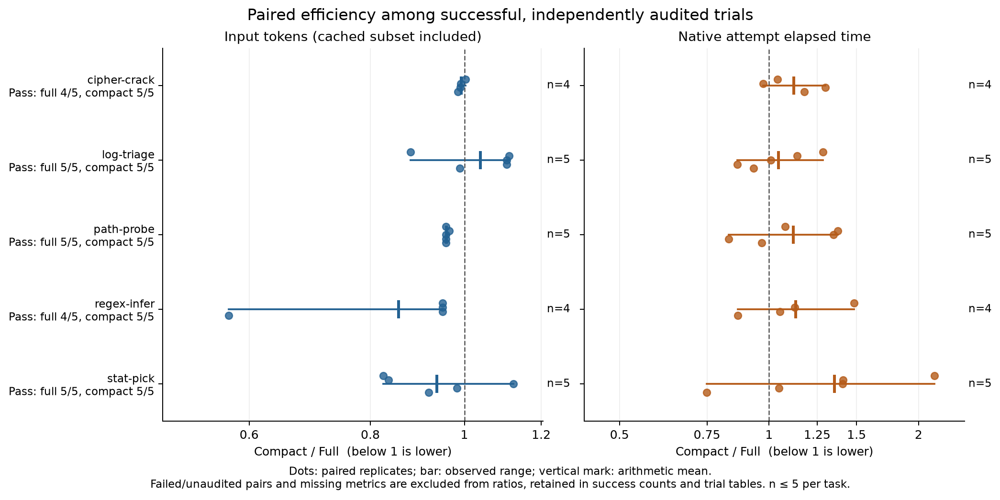

# Less Formatting, Same Information

Yifei Wang — **NetID: yw251** — solo submission  
COMP 580, final project  
Evaluation completed: November 23, 2026, Central Time (November 24, 05:04 UTC)  
Submission repository: <https://github.com/a-little-hoof/580-final>.

This source follows the ten sections in [assignment.txt](../assignment.txt). Artifact links are relative to this repository. [Submission status and limitations](../docs/REPORT_GAPS.md) records the single-model and contribution-workflow limits.

## 0. Explore and Evaluate the App

Before implementing the formatting change, I explored the installed RUSH Lab app through its native interface and ran one fresh NanoAgent Session on each of five selected cases. Each successful request named only the task and case, for example, `Run the triage-log task on the edge-proxy case.` The other four task/case pairs appear below. The installed plugins all reported version `0.1.0`; exact source commits, prompts, session identities and evidence hashes are preserved in [the Task 0 manifest](../study/task0/manifest.json). The observed engine was `2026-11-23T03-56-59-663Z-7ac1754`.

Settings exposed `deepseek/deepseek-v4-flash-0731` with no model selector. The audited scored-Harness interface also pins a single model; an arbitrary model override is not a supported scored comparison in this deployment. Consequently this exploration covers **one available model**, and does not fulfill the assignment's requested exploration across different models. This limitation remains explicit rather than substituting an untested model. The source and runtime audit is in [HARNESS_CONTRACT.md](../docs/HARNESS_CONTRACT.md).

All successful rows use **Flash-0731**, shorthand for `deepseek/deepseek-v4-flash-0731`.

| Task / case | Model | Cached input | Input tokens | Output tokens | Outcome | Latency (s) |
| --- | --- | ---: | ---: | ---: | --- | ---: |
| Log Triage / edge-proxy | Flash-0731 | 1,024 | 3,699 | 794 | Pass | 19.9971 |
| Cipher Crack / telegram | Flash-0731 | 6,912 | 11,581 | 1,952 | Pass | 27.4156 |
| Path Probe / quarry | Flash-0731 | 5,632 | 10,178 | 1,069 | Pass | 22.3384 |
| Regex / widget-code | Flash-0731 | 2,560 | 6,643 | 769 | Pass | 16.1301 |
| Stat Pick / sensor-drift | Flash-0731 | 2,048 | 4,793 | 1,280 | Pass | 29.1667 |

Two earlier Log Triage / edge-proxy attempts used the same configured model but failed authentication. Cached/input/output tokens, latency and task correctness are **unknown** for both.

| Earlier attempt | Failure location and reason |
| --- | --- |
| 1 | OpenRouter HTTP 401: expired API key, before a model response or task invocation. |
| 2 | OpenRouter HTTP 401 persisted after a reported key replacement, before a model response or task invocation. |

Successful-row tokens include both outer chat-loop and nested task model-call records from the saved execution graphs, counted once per record. Their input/output totals match the captured UI totals. Cached input is already included in input; reasoning is already included in output. Latency is the native export's end-to-end turn measurement, not a sum of model time and tool time. Native JSONL token counters alone omit nested inference on this path. The [pilot table](../study/task0/summaries/pilot-results.md), [graph accounting](../study/task0/summaries/graph-accounting.json) and [accounting audit](../docs/TRACE_ACCOUNTING.md) retain the derivation and coverage. Pass means the recorded task verdict has `valid: true`, not merely a high score or an assistant claim.

The two earlier errors are distinct retained sessions, not incorrect task answers or zero-token runs. Their exact prompts and failure evidence are in [the current-pilot summary](../study/task0/summaries/current-pilot.md). Authentication was subsequently restored before the five successful pilots. Historical October sessions contain additional turns and corrections and are excluded from these fresh observations and the controlled trials. One successful observation per task does not estimate reliability or establish an efficiency improvement.

## 1. Task Selection

The five cases exercise different kinds of structured tool data. **Log Triage** identifies a fault and cites a diagnostic line from eight ordered log lines. **Cipher Crack** recovers a Caesar key and plaintext from a short ciphertext. **Path Probe** finds an optimal route through a six-node, seven-edge weighted graph. **Regex From Examples** proposes a pattern from thirteen labelled examples, with correctness judged against ten private held-out examples. **Stat Pick** selects the statistic requested by a natural-language question and computes it for eleven readings. Task identities are respectively `triage-log`, `crack-cipher`, `find-route`, `infer-pattern`, and `answer-question`.

These tasks vary between long strings, lists, nested records and numerical reasoning, making them useful small controls for a JSON-formatting intervention. They are not a representative sample of all agent workloads. The observed raw-text public results were small: the largest captured result was 147 bytes for Cipher, 303 for Path and 535 for Regex. Original wire sizes were unavailable for structured Log and Stat graph values. These observations weakened the original bounded-preview proposal; no large dumps or padded data were added to manufacture a benefit. The selected experiment instead tests whether removing presentation whitespace has a measurable effect on these naturally small inputs.

## 2. Task Validation

The private host validator [validate.py](../study/controlled/validators/validate.py) makes no LLM calls. It checks strict answer JSON, the selected case and declared field types, and exact public-file integrity before reporting semantic validity separately. It rejects missing or additional fields, duplicate JSON keys, nonfinite numbers, booleans in numeric fields, modified inputs and symlinked required files. A verifier error is distinct from a wrong answer; missing verdicts remain unknown. The platform's original plugin verdict remains the authoritative RUSH result, while the independent host checks provide a separately labelled audit.

| Task | Deterministic semantic check and defined scope |
| --- | --- |
| Log | Compare the exact fault enum and an accepted diagnostic line, allowing only outer evidence whitespace. Alternative accepted citations pass. Correct fault with an invented or nondiagnostic citation receives partial credit but does not pass. This checks agreement with a fixed label/citation reference, not independent causal proof. |
| Cipher | Normalize outer whitespace and case as upstream does; validate key/plaintext syntax; independently decrypt the ciphertext and require both decryption consistency and the expected plaintext. A wrong key with the correct plaintext can receive score 1 while `valid` is false, so success never uses score alone. |
| Path | Verify endpoints, simple path, existing edges and exact summed integer cost. Independently enumerate simple paths on the fixed six-node graph to establish the optimum. Both optimal routes pass; an admissible but more expensive route fails. |
| Regex | Enforce the pinned syntax, length, outer-whitespace and lexical nested-quantifier restrictions. Run Python `re.fullmatch` on each of the ten private examples in a bounded subprocess. Success means agreement on this finite set, not equivalence to an intended language. Matching timeout is a verifier error. |
| Stat | Require the expected statistic and independently compute its value, using population deviation for this case. Apply tolerance `1e-6 * max(1, abs(expected))`; reject malformed or nonrepresentable numerical values. |

Public fixtures were extracted from pinned source literals with an explicit field allowlist and `ast.literal_eval`; no plugin module was imported or executed. Source versions, commits, source-file hashes, public-file hashes and the preserved MIT notice are in [the fixture manifest](../study/controlled/fixtures/manifest.json). Expected answers, hidden labels, the regex holdouts and validation code remain under `study/controlled/validators/`, outside the CLI package and evaluated workspace. Only each case's `input.json` and `prompt.txt` are staged. Network access was disabled for the frozen scored runs because the public upstream repositories also contain solution references. Python within the agent is not a host filesystem sandbox; isolation therefore depends on the Harness VM and the strict staging boundary.

The 23 offline [validator tests](../study/controlled/tests/test_validators.py) cover valid answers and targeted counterexamples: both shortest routes and accepted citations, wrong-key/score-1 behavior, normalization and internal whitespace, wrong statistics/values, malformed types and JSON, huge integers, input mutations, regex memorization and matching timeout. Independent arithmetic and exhaustive graph enumeration cross-check reference calculations. These checks support the specified fixed-case semantics; they cannot establish correctness for arbitrary future tasks or all possible regex languages. A separate native scored Log Triage smoke passed after the platform compatibility fix described in Section 6; it was excluded from the frozen trials.

Coding assistance was used to develop the validators. The actual implementation prompt was:

> User approved lossless compact formatting. Implement public fixtures + private deterministic validators and meaningful tests, exclusively under study/controlled/{fixtures,validators,tests} and docs/ADAPTERS.md. Read draft and contracts. Use AST literal extraction explicit allowlist; no plugin execution or model calls. Each case directory input.json plus prompt.txt with public task definitions/schema/case exact data. Same tasks/cases as pilots; clearly fullgraph/rawstats adaptation. Keep private validator reference data outside publicfixtures/package. Validate typed answer and integrity, reproduce upstream acceptance nuances. Need manifest input hashes/source versions/extraction provenance/license. Do not edit projectroot plan/README. Communicate interface/files for baselineagent. Do not include known answer/hiddenlabels in prompts or fixture files.

The integration clarification and concrete review prompt about rejecting `10**1000` without an uncaught overflow are preserved verbatim, together with the implementation request, in [validators/DEVELOPMENT.md](../study/controlled/validators/DEVELOPMENT.md). The machine-readable [development prompt record](../study/controlled/development/prompts.jsonl) includes the user's approved intervention and delegated fixture/validator prompts. The additional recorded validator-development prompts appear in the appendix.

## 3. Your Idea and Hypothesis

The intervention changes only how JSON tool results are rendered before they enter model context. The baseline uses `json.dumps(value, ensure_ascii=False, indent=2, allow_nan=False)`; the treatment uses the same call with `separators=(',', ':')` instead of indentation. Every field, typed value, key order, array order and character inside string values is preserved. No summarization, field omission, retrieval, table encoding or history rewriting occurs. Nested records and lists can occupy fewer bytes when their indentation and separator whitespace are removed, and repeated model requests may otherwise reprocess those formatting tokens.

The concrete hypothesis is that compact JSON lowers cumulative model input tokens on the five adapted cases without lowering verifier success, compared with the same original CLI using indented JSON. This is a hypothesis, not a result. Short inputs, tokenization, cache behavior, reasoning variation and different tool choices may make the measured effect small or negative. A shorter serialization alone does not establish fewer model tokens, lower latency or lower cost; those claims require the matched trials below.

## 4. Dataset Design and Variation

The study fixes one case per task, rather than generating new examples after observing outcomes. The adapters preserve the selected source data but change access where generic CLI tools replace plugin tools. Log and Cipher expose their original log/ciphertext in files. Regex exposes only the thirteen visible labels. **Path exposes the full graph instead of incremental neighbour discovery, and Stat exposes raw readings instead of a summary-only interface.** These are substantive task adaptations, shared by both experimental conditions. The native Session pilots must therefore not be treated as a causal baseline for the adapted CLI. Exact public fields and schema boundaries are documented in [ADAPTERS.md](../docs/ADAPTERS.md).

The variation in strings, graph records, labelled examples and numbers lets the experiment test whether formatting effects depend on representation. Five small, reused cases are sufficient for a narrow within-case mechanism check, but insufficient for a general efficiency claim or broad success guarantee. Five repetitions per condition characterize variation on these cases; they do not create twenty-five independent task examples. Both conditions receive identical fixture bytes and exact prompts, and prompts allow any available tool strategy. There is no instruction to read all data, use a particular tool or produce an artificially long result.

Before final evaluation, I froze the code/package hashes, fixture and prompt hashes, common model/version, limits, benchmark publications and all fifty run requests in [freeze.json](../study/controlled/final/freeze.json). Its canonical freeze identity (SHA-256 excluding the identity field itself) is `7301cf30de5307b76458758b5d8c6df778737684024440ca5f163c419374214a`. A deterministic SHA-256 ordering with seed 580 shuffles 25 case/replicate pairs and chooses the full/compact order within each pair. Each trial starts in a fresh workspace. Private answers and Task 0 graphs remain outside agent workspaces. Provider caches cannot be reset by a workspace reset, so cached tokens and the complete order are retained. Failed logical trials remain in the schedule; the script does not replace them or stop on favorable interim results.

## 5. Baseline and Fair Comparisons

The controlled baseline is the original standard-library Python CLI in [src/comp580_agent](../src/comp580_agent), using `--condition full`. Its treatment is the same CLI with `--condition compact`. NanoAgent's [pinned course source](https://github.com/RUSH-LAB/nanoagent/tree/189454718dad10404b92147b52dc07b3e6a8e598) supplied the app/API and task-contract reference; the agent loop was implemented independently rather than copied from it. The five NanoAgent Session runs in Section 0 are exploratory observations. They are not the full-versus-compact baseline comparison.

One original full-mode **development smoke test** completed in the actual Harness terminal before compact implementation. Its Log Triage answer passed the local checker. The retained v0.1.0 run reports 2 dispatched model calls, 2,350 input tokens, 0 cached input tokens, 199 output tokens and 18.0629 seconds measured by the agent's monotonic clock. This was an unscored installation/loop check with a 4,096-token output cap, not a frozen benchmark trial. Its [capture](../study/controlled/development/smoke-terminal-full/capture.json), [run settings](../study/controlled/development/smoke-terminal-full/.comp580_logs/73973d9437ef4906b7ccc2283d405d91/run.json) and [raw per-call result](../study/controlled/development/smoke-terminal-full/.comp580_logs/73973d9437ef4906b7ccc2283d405d91/result.json) are preserved. The wheel SHA-256 is `12be51e1d896d33ac5738e2adebf4f56acb3e9c95eed70eb5c40a3b9d882486b`.

Both final conditions use the same frozen v0.2.0 wheel and code fingerprint, `deepseek/deepseek-v4-flash-0731`, temperature 0, exact user/system prompts, tool schemas, public files and stopping rules. The shared limits are 12 model calls, 180 seconds per attempt, 60 seconds per model request, 10 seconds per tool, 32,768 output tokens per call, a 64-KiB full-form tool-result ceiling and a separate 2-MiB response ceiling. The output cap is the same in both modes. Published benchmarks disable internet access and set a $0.05 per-attempt admission ceiling; automatic worker retries can increase total attempts, so this is not a study-wide cost bound. OpenRouter routing is pinned to the same allowed providers, DeepInfra and Nebius. The native scored smoke's pass, package identity and complete usage coverage are preserved separately. Section 8 reports the final numerical full-mode baseline beside compact mode.

## 6. Harness Modifications

The CLI is installed as `comp580-agent` in the RUSH Lab Harness terminal and invoked through `rush comp580-agent --condition full` or `rush comp580-agent --condition compact`; RUSH appends the exact task prompt. The shared loop uses the supplied gateway, fixed `RUSH_MODEL`, supplied output-token cap, and five generic tools: `read_json`, `read_file`, literal unpaginated `search_file`, standard-library `run_python`, and atomic `write_answer`. It writes `answer.json` and leaves semantic judgment to the private verifier. The shared prompts contain no task-specific solver or hidden reference information.

The intervention is localized to [format_tool_result](../src/comp580_agent/tools.py); the condition flag chooses its JSON presentation. The [agent loop](../src/comp580_agent/agent.py) checks the same full-form 64-KiB ceiling before either presentation, so compact mode cannot gain an unrelated larger effective result budget. Both modes save raw and model-visible tool evidence and call records. Missing provider usage remains unknown, and the pre-dispatch deadline check does not count a request that was never dispatched. Runtime files and logs are excluded from public input tools and frozen-input hashing. [Offline treatment tests](../tests/test_compact.py) check typed round trips, Unicode and whitespace inside strings, nested structures, identical initial requests and equal rejection at the shared limit. They establish implementation invariants, not empirical efficiency.

A platform compatibility error initially blocked benchmark publication: the answer-template builder rejected enum-only scalar schemas generated by all five plugin contracts. A local, backed-up patch makes those fields start as unfilled `null`, matching the builder's existing scalar behavior. It changes no plugin schema, answer or verifier. Seven targeted tests, including all five actual schemas, and twenty untouched upstream outcome tests passed. Native publication and scored execution then succeeded. The patch hash and applied-runtime provenance are included in the freeze and are shared by both conditions. The original agent wheel contains none of the platform code. See the [compatibility record](../study/controlled/development/platform-fix/README.md).

## 7. Evaluation Metrics

The three primary metrics are **verifier success**, **cumulative input tokens**, and **end-to-end attempt elapsed time**. Success protects against false savings from incomplete or incorrect answers; input tokens test the proposed mechanism; elapsed time measures user-visible impact. Cached input is reported as a subset of input, and output includes reported reasoning. Model/tool counts, raw/model-visible tool bytes, failures and measurement coverage are retained alongside these primary metrics. Agent elapsed time and platform attempt elapsed time have different boundaries and must remain separately labelled. Provider-reported cost, when present, is supplementary; no runtime price calculation is asserted to be a verified bill.

The frozen design has five cases x two conditions x five repetitions: **50 logical trials**. The server may automatically retry worker errors; analysis retains every actual attempt and sums their tokens and elapsed times within the original logical trial. Per-case summaries show means, sample standard deviations and success counts. Paired efficiency ratios are computed only where both conditions pass and the corresponding measurements are complete; all failed or unknown trials remain visible in the underlying tables. A fast failure is not a saving. With five repeats per case, variability is descriptive and cannot establish general reliability or isolate a small latency effect. Provider routing, queue/network time, caching, reasoning variation, nondeterminism despite temperature 0 and tool choices can all affect results. The model client makes no retries, while provider-side routing can include unsuccessful endpoint responses before a returned response; these are retained as routing metadata, not counted as additional dispatched agent calls.

## 8. Experimental Results

All **50 frozen logical trials completed as 50 actual attempts**, with no worker retries or replacement trials. Native and independent validity judgments agreed on all 50: **full passed 23/25 and compact passed 25/25**. Every attempt matched the frozen package/condition identity, and capture/hash/accounting consistency checks found no discrepancy. Forty-nine attempts have complete token and settled-cost measurements; the Regex timeout has one missing call's usage/cost. Its known subtotals remain available and are not represented as complete totals. All data are in the [final analysis](../study/controlled/final/analysis/analysis.json), [trial table](../study/controlled/final/analysis/trials.csv), [failure table](../study/controlled/final/analysis/failures.csv) and [paired table](../study/controlled/final/analysis/pairs.csv).

The table reports **mean ± sample SD over successful, independently audited trials**; n is the number contributing to every metric in that row. Pass counts always include all five scheduled trials. These conditional measurements do not include the failures described immediately below. Native elapsed time is the primary latency measure; agent time has a narrower boundary. Cost summaries and all-trial latency distributions are retained in the linked analysis.

| Task / mode | Pass; metric n | Input | Cached subset | Output | Native s | Agent s |
| --- | --- | ---: | ---: | ---: | ---: | ---: |
| Log / full | 5/5; n=5 | 2,970.0 ± 161.0 | 2,457.6 ± 229.0 | 195.8 ± 27.0 | 8.31 ± 0.79 | 5.04 ± 0.96 |
| Log / compact | 5/5; n=5 | 3,073.4 ± 188.5 | 2,355.2 ± 280.4 | 213.0 ± 22.3 | 8.60 ± 0.85 | 5.24 ± 0.83 |
| Cipher / full | 4/5; n=4 | 4,418.5 ± 16.8 | 2,816.0 ± 512.0 | 305.0 ± 28.0 | 11.44 ± 1.93 | 7.47 ± 2.34 |
| Cipher / compact | 5/5; n=5 | 4,387.6 ± 22.2 | 2,867.2 ± 457.9 | 324.6 ± 23.5 | 12.56 ± 3.45 | 8.88 ± 3.89 |
| Path / full | 5/5; n=5 | 2,619.0 ± 8.9 | 1,996.8 ± 420.7 | 231.0 ± 11.5 | 8.60 ± 1.49 | 5.54 ± 1.40 |
| Path / compact | 5/5; n=5 | 2,511.0 ± 11.0 | 1,382.4 ± 530.9 | 236.6 ± 15.7 | 9.52 ± 2.11 | 6.32 ± 1.92 |
| Regex / full | 4/5; n=4 | 3,074.5 ± 873.0 | 2,240.0 ± 1,052.9 | 545.2 ± 178.0 | 12.42 ± 3.46 | 9.35 ± 3.26 |
| Regex / compact | 5/5; n=5 | 2,825.2 ± 713.8 | 2,457.6 ± 642.6 | 537.2 ± 209.6 | 13.54 ± 1.98 | 10.33 ± 1.76 |
| Stat / full | 5/5; n=5 | 4,519.8 ± 361.0 | 2,969.6 ± 642.6 | 645.6 ± 65.1 | 13.39 ± 2.29 | 10.03 ± 2.27 |
| Stat / compact | 5/5; n=5 | 4,207.0 ± 332.9 | 3,020.8 ± 662.6 | 625.0 ± 92.9 | 17.37 ± 4.68 | 14.08 ± 4.74 |

The two full-mode failures are retained explicitly. **Cipher, repetition 2**, completed its agent loop but returned a key inconsistent with the correct plaintext: native failure and independent `key_plaintext_disagree`, despite plaintext score 1.0. It used 4,433 input tokens (3,328 cached), 293 output tokens, 10.4169 native seconds and 6.7806 agent seconds; settled cost was $0.00025344. **Regex, repetition 3**, timed out on its third model request after the common 60-second request limit and left the unfilled answer template. Native elapsed time was 107.3908 seconds and agent time 104.3703 seconds. Its total input/cache/output tokens and cost are unknown; the first two calls contribute known subtotals of 2,638/2,304/3,827 tokens and $0.00111519. Neither failure was rerun. Including failures, all-five-trial native means are Cipher full 11.23 ± 1.74 versus compact 12.56 ± 3.45 seconds, and Regex full 31.42 ± 42.58 versus compact 13.54 ± 1.98 seconds. The Regex all-trial difference is dominated by one timeout and is not proof that minification prevents timeouts.

**Figure 1.** Each dot is one compact/full ratio for a pair in which both conditions passed and measurements were complete. The mark shows the arithmetic mean and the line the observed range, not a confidence interval. Cipher and Regex contribute four pairs; the other tasks contribute five. These means of paired ratios differ from ratios of the condition means above. All five task means for successful-pair native latency exceed 1; this sample provides no consistent latency benefit.

**Log Triage.** Both modes passed 5/5. Compact input averaged 3,073.4 versus full 2,970.0 tokens; the paired ratio was 1.039 ± 0.103 (range 0.880–1.111), a mean increase of 103.4 tokens. The native-time ratio was 1.045 ± 0.168, also providing no improvement. Both conditions used two model calls per trial, but compact made three extra `read_file` calls across the five trials versus one in full. These extra reads were selected in the first response, before any formatted tool result was seen; their imbalance is baseline model variability, not evidence that formatting caused the choices.

Compact removed 85 bytes from each ordinary structured log result (788 to 703), but additional reads outweighed this local saving in several trajectories. Text returned by `read_file` preserves internal formatting as part of a string value. The result rejects an unconditional token-saving claim for Log on this small sample: lossless minification works locally, while cumulative model input depends on which information the model requests.

**Cipher Crack.** Full passed 4/5 and compact 5/5; the full failure above illustrates why a correct-looking plaintext and score 1 are insufficient without checking the key. All ten runs used three model calls and one each of `read_json`, `run_python` and `write_answer`. Among four successful pairs, the input ratio was 0.993 ± 0.008 (range 0.985–1.003), a mean saving of just 33 tokens. Native latency was 1.122 ± 0.145 times full, with no observed speedup on average.

Compact removed 37 delivered tool-result bytes per run. Ciphertext, plaintext and Python output remain strings, so their internal content cannot be shortened by this intervention. Small differences in Python output and generated content are comparable to the whitespace savings. The observed success difference is two groups of only five trials; it does not establish a reliability improvement or show that formatting caused the incorrect key.

**Path Probe.** Both modes passed 5/5 and used the same simple two-call trajectory: read the graph, then write the route. Each compact structured graph result occupied 311 bytes versus 660 in full, a 52.9% reduction in that delivered result. Cumulative model input fell from 2,619.0 to 2,511.0 tokens on average: paired ratio 0.959 ± 0.003 (range 0.957–0.965), or about 4.1% lower. This is the clearest, most consistent within-case evidence for the proposed token mechanism; the shared full-graph adapter is held fixed.

The large relative result-byte reduction translated into a much smaller total-token reduction because system/user prompts, schemas and other request content still dominate. Native latency rose from 8.60 to 9.52 seconds on average, with paired ratio 1.120 ± 0.238. Cached input averaged 1,996.8 tokens in full versus 1,382.4 in compact; mean settled cost was $0.000175 versus $0.000221. Fewer total input tokens therefore did not produce a cost or latency improvement in these observations.

**Regex From Examples.** Full passed 4/5 and compact 5/5 on the finite private holdout. The timeout prevents a complete token comparison for repetition 3. Among the other four pairs, the input ratio averaged 0.855 ± 0.189 (range 0.572–0.950). Three pairs used two calls in both modes and saved exactly 132 input tokens, about 5.0%; the fourth used an additional Python/model round in full and saved 1,878 tokens. Thus the apparently larger 14.5% mean paired saving is strongly affected by one trajectory difference, not just separator whitespace. The ordinary structured example result shrank from 981 to 510 bytes.

Successful-pair native latency averaged a ratio of 1.132 ± 0.258 despite those token reductions. The compact member paired with the failed full run used three calls and passed; it appears in compact's condition mean but is excluded from efficiency ratios. All outcome and latency summaries retain the timeout. Passing these ten private examples demonstrates finite-set agreement, not proof that every accepted regex defines the intended language, and one failure difference cannot establish improved general reliability.

**Stat Pick.** Both modes passed 5/5 with the correct statistic and numerical value, using three model calls each. Compact input averaged 4,207.0 versus 4,519.8 tokens; the paired ratio was 0.937 ± 0.122 (range 0.825–1.123), a mean saving of 312.8 tokens with substantial variability. All trials used `read_json` and `run_python`. Full additionally requested three `read_file` results and one `search_file` result; compact requested one extra `read_file` result. As with Log, these extra requests occurred before the first formatted result, so the imbalance limits attribution of the observed reduction to minification alone.

Native time increased from 13.39 to 17.37 seconds on average, with paired ratio 1.353 ± 0.526 (range 0.748–2.153). Agent time similarly increased from 10.03 to 14.08 seconds. Mean settled cost was lower, $0.000356 versus $0.000408, but cached tokens, generated content and provider timing varied. This case supports a modest observed token reduction, not a stable latency reduction. The raw-reading interface is the same in both conditions; its difference from the native summary interface is not credited to formatting.

## 9. Conclusion

Lossless compact JSON reduced the bytes of every affected tool result, but these fifty trials support a narrower efficiency claim than the original hypothesis. Path showed a consistent roughly 4.1% paired input-token reduction; the simple Regex trajectories showed about 5.0%. Cipher's saving was small, while Log increased and Stat/Regex averages were sensitive to different tool trajectories. Compact passed 25/25 versus full 23/25, but the two baseline failures and five repetitions per fixed case are insufficient to claim a reliability gain. Successful-pair native latency did not improve consistently, and lower token totals did not guarantee lower cost. The evidence therefore supports compact formatting as a small representation-level token optimization for structured results, not a general agent speedup. Generalization is limited by five tiny adapted cases, provider/cache variability, and the single available model; the assignment's requested multi-model exploration remains unmet.

## Appendix: Reproduction and validator prompts

The original CLI has no runtime Python dependencies and requires Python 3.12 or newer. The evaluated Harness VM used Python 3.12.16. The final wheel SHA-256 is `0575291280cfcc1dbb1b6898741b5edcd831796aad141cc4a48a41116b0a4aa8`; its installed module fingerprint is `b3c217bb78ca06df3a6090030f1ecbcdb8ba65c2688ca8bd1fae7c11ee89ab9b`. Every evaluated command checks that fingerprint before any model request. The [Makefile](../Makefile) runs offline tests, builds the wheel, regenerates analysis and renders this PDF. The final suite has 121 offline tests (including 24 analysis tests); an extraction without optional upstream checkouts skips only the source-rebuild provenance test. Seven targeted and twenty upstream platform tests passed separately before evaluation. Raw trial evidence, the fixed run order, individual outcomes and analysis code are retained in the submission repository. The five public fixture adaptations retain their upstream MIT notice; NanoAgent's reference implementation is excluded from the submission.

Section 2 reproduces the initial validator implementation prompt. The two further recorded development prompts were:

> Interface approved. Coordinate manifest shape with inspect_path_stat_regex agent implementing dryrun benchmarkhelper. Fixtureprompt identical conditions; original Session caseprompt difference declared. Need do not force full outputs or use read_json specifically; natural prompt says input file. Ensure license source notices and private truthisolated.

> Early validatorreview looks good. Please test huge integer stat.value (e.g10**1000) causing OverflowError subtractfloat; should deterministicreject false notuncaughtcrash. Sourceinterface metadata/hashesgood. Root wrote study/controlled/prepare_workspace.py twofileallowlist newdironly, noconflict. Final testsinclude missing/modifiedpromptinput, extra fields andtypeboolcost, syntacticinvalidduplicate/NaN/overflowJSON.
